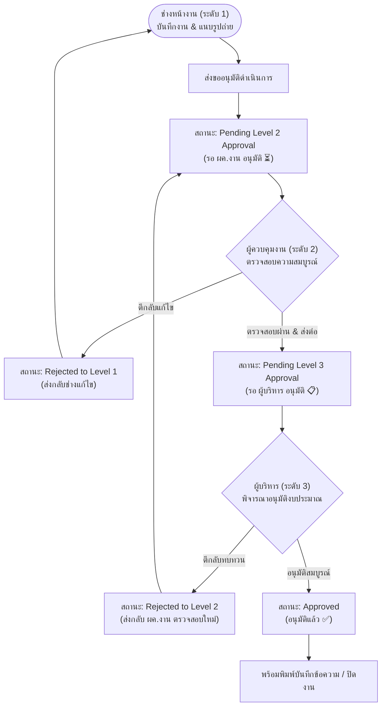

# เอกสารสรุปเงื่อนไขการพัฒนาระบบ ปัญหา และแนวทางแก้ไข (System Specification & Change Reference)
**ระบบบริหารงานซ่อมบำรุงและควบคุมมาตรฐานวิศวกรรมอาคาร (FMMS Enterprise)**  
**Version:** `v2.5.0-ENT` | **อัปเดตล่าสุด:** 27 ตุลาคม 2569

---

## 1. วัตถุประสงค์ของเอกสาร
เอกสารฉบับนี้จัดทำขึ้นเพื่อรวบรวม **เงื่อนไขสถาปัตยกรรมระบบ (Specifications)**, **ข้อกำหนดด้านสิทธิ์และความปลอดภัย (RBAC & Approval Workflow)**, **สรุปประวัติปัญหาและวิธีแก้ไข (Troubleshooting & Fixes)** รวมถึง **ข้อควรระวังในการพัฒนาต่อยอดครั้งต่อไป** เพื่อให้ทีมพัฒนาและผู้ดูแลระบบใช้เป็นมาตรฐานอ้างอิงชุดเดียวกัน ป้องกันข้อผิดพลาดซ้ำซ้อน และรักษาเสถียรภาพของระบบ

---

## 2. โครงสร้างและสิทธิ์การเข้าใช้งาน (Hierarchical RBAC Matrix)

ระบบแบ่งระดับผู้ใช้งานออกเป็น 4 ระดับ โดยมีหลักการสำคัญคือ **"ระดับต่ำกว่าไม่สามารถมองเห็นหรือเข้าถึงข้อมูล/ฟังก์ชันของระดับสูงกว่าได้เด็ดขาด"**

| ระดับ (Role) | บัญชีผู้ใช้ (Username / Password) | สิทธิ์หน้าที่หลัก (Core Responsibilities) | ข้อจำกัดสิทธิ์และความปลอดภัย (Access Restrictions) |
| :--- | :--- | :--- | :--- |
| **ระดับ 1 (Level 1)**<br>ช่างหน้างาน *(technician)* | `tech1` / `tech123` | • เปิดใบแจ้งซ่อม (CM / PM)<br>• บันทึกผลการซ่อม/ค่าใช้จ่าย<br>• อัปโหลดภาพถ่ายก่อน-หลัง<br>• ส่งขออนุมัติไปยังผู้ควบคุมงาน | • **ห้ามเข้าถึง** รายงานระดับ 2 และ 3<br>• หากพยายามเปิด จะแสดงหน้าต่างเตือน **"🚫 สิทธิ์การเข้าถึงไม่เพียงพอ"**<br>• ไม่สามารถอนุมัติงานของตนเองได้ |
| **ระดับ 2 (Level 2)**<br>ผู้ควบคุมงาน *(supervisor)* | `super1` / `super123` | • ตรวจสอบงานช่าง (Option 1 & 2 Cards)<br>• อนุมัติและส่งต่อผู้บริหารระดับ 3<br>• สั่งตีกลับงานให้ช่างแก้ไข<br>• สร้างบันทึกข้อความ (Approval Memo) | • **ห้ามเข้าถึง** รายงานและเมนูของผู้บริหารระดับ 3<br>• ไม่สามารถอนุมัติขั้นสุดท้าย (Final Approval) ในงานที่เกินอำนาจหน้าที่ได้ |
| **ระดับ 3 (Level 3)**<br>ผู้บริหาร *(executive)* | `exec1` / `exec123` | • ตรวจสอบภาพรวมทั้งองค์กร (Executive Dashboard)<br>• พิจารณาอนุมัติขั้นสุดท้าย (Approve / Reject to Level 2)<br>• พรีวิวรายงาน A4 และสั่งพิมพ์เอกสาร<br>• แก้ไขรายละเอียดใบงานและงบประมาณ | • มีสิทธิ์เห็นข้อมูลทุกระดับ<br>• มีอำนาจตัดสินใจอนุมัติหรือตีกลับงาน |
| **Super Admin**<br>ผู้ดูแลระบบ *(admin)* | `admin` / `admin123` | • จัดการผู้ใช้งาน (เพิ่ม/ลบ/เปลี่ยนสิทธิ์)<br>• ตั้งค่าการเชื่อมต่อ Google Apps Script / Sheets / Drive<br>• ตรวจสอบ System Logs และสำรองข้อมูลระบบ | • ดูแลความมั่นคงปลอดภัยและสถาปัตยกรรมระบบในภาพรวม |

---

## 3. ขั้นตอนการอนุมัติงาน 2 ลำดับขั้น (2-Tier Sequential Approval Workflow)

ระบบกำหนดให้การดำเนินการซ่อมบำรุงและขออนุมัติงบประมาณต้องผ่านขั้นตอนตามลำดับ ไม่สามารถข้ามขั้นตอนได้:



### กลไกการแจ้งเตือน (Notification Mechanics):
1. **กระดิ่งแจ้งเตือนบน Navbar (`🔔 รออนุมัติ (X)`):**
   - แสดงผลแบบ Live Count สำหรับผู้ใช้ระดับ 2 และ 3
   - แสดงสีส้มกะพริบ (Pulsing Animation) เพื่อเตือนให้เข้าพิจารณา
2. **Popup แจ้งเตือนเมื่อเข้าสู่ระบบ (`#approvalAlertModal`):**
   - เมื่อระดับ 2 หรือ 3 ล็อกอินเข้าระบบ หากมีงานค้างอนุมัติ หน้าต่างจะเด้งขึ้นมาพร้อมรายชื่องาน และปุ่มกดตรงเข้าสู่การอนุมัติทันที

---

## 4. มาตรฐานเอกสารและงานพิมพ์ (Printing & Typography Standard)

| รายการ | มาตรฐานที่กำหนด (Specification) | หมายเหตุ / จุดสังเกต |
| :--- | :--- | :--- |
| **ชนิดฟอนต์ (Font Family)** | `TH Sarabun New`, `TH SarabunPSK`, sans-serif | ติดตั้งผ่าน Google Fonts และ Fallback System |
| **ขนาดตัวอักษรเนื้อหา (Body)** | **12pt** | ใช้อ่านง่าย สบายตา และตรงตามฟอร์มราชการ/องค์กร |
| **ขนาดหัวข้อย่อย (Sub-Header)** | **14pt (Bold)** | ใหญ่กว่าเนื้อหา 2 ขนาด เพื่อแยกหมวดหมู่งานชัดเจน |
| **ขนาดหัวข้อหลัก (Title / Header)** | **16pt (Bold)** | ใหญ่กว่าเนื้อหา 4 ขนาด เน้นความโดดเด่นของเอกสาร |
| **ข้อความมาตรฐานรับรอง** | **ตัดข้อความ ISO 41001 ออกทั้งหมด** | ให้แสดงเป็นเลขเวอร์ชันของระบบ `v2.5.0-ENT` แทน |
| **การแสดงผลเมื่อสั่งพิมพ์ (`@media print`)** | • ซ่อน Navbar, เมนู, และส่วนประกอบแอปทั้งหมด (`body > main { display: none !important; }`)<br>• บังคับแสดงเฉพาะโมดอลพิมพ์และแผ่นเอกสาร A4 (`.a4-paper-sheet`)<br>• พื้นหลังสีขาว 100% ตัวอักษรสีดำเข้ม คมชัด ไม่แตก ไม่ขึ้นหน้าเปล่า |

---

## 5. สรุปปัญหา สาเหตุ และแนวทางแก้ไข (Root Cause Analysis & Resolutions)

### ปัญหาที่ 1: เข้าเว็บแล้วไม่ผ่านหน้า Landing Page และปุ่ม Logout ไม่แสดงบนเว็บจริง
- **สาเหตุ**:
  1. เครื่องคอมพิวเตอร์ Local มีการพัฒนาโค้ดไปแล้วหลายคอมมิต แต่ยังไม่ได้ทำการ `git push origin main` ขึ้นไปยัง GitHub Repository บนเว็บจริง (`https://doit-on.github.io/MA-TWPP/`) จึงยังรันโค้ดเก่า (`a2ba012`)
  2. โค้ดใน `init()` ตรวจพบ Session ใน `localStorage` จึงสั่งข้ามไปหน้า Dashboard อัตโนมัติ
- **วิธีแก้ไข**:
  1. เพิ่มคำสั่ง `showLandingPage()` ที่บรรทัดสุดท้ายของ `init()` ใน `app.js` เพื่อล็อกให้ทุกครั้งที่โหลดเว็บต้องผ่านหน้า Landing Page เสมอ
  2. สร้างปุ่ม `🚪 ออกจากระบบ` สีแดงสดที่ Navbar ใน `index.html` ผูกกับฟังก์ชัน `FMMS.logout()` เพื่อล้าง Session และดีดกลับ Landing Page ทันที
  3. ทำการ Commit การแก้ไข และเตรียม Push ขึ้น GitHub

### ปัญหาที่ 2: กดสั่งพิมพ์รายงานผู้บริหารแล้วขึ้นเป็นหน้าเปล่า (Blank Page ใน Print Preview)
- **สาเหตุ**:
  1. ฟังก์ชัน `printExecutiveReport()` สั่งเรียก `window.print()` ทันทีโดยที่ยังไม่ได้สร้างเนื้อหาเอกสารลงใน `#a4PaperContainer`
  2. CSS เดิมมีคลาส `.hidden { display: none !important; }` ซึ่งไปทับการแสดงผลของ Modal ในระหว่างพิมพ์
- **วิธีแก้ไข**:
  1. เชื่อมต่อ `printExecutiveReport()` ให้เรียก `openExecutiveReportPrintModal()` เพื่อ Render ข้อมูลใส่ตาราง A4 ให้เรียบร้อยก่อนเรียกคำสั่งพิมพ์
  2. ปรับแต่ง `@media print` ใน `style.css` ใหม่ ให้ Override คลาสซ่อน และบังคับแสดง `#memoPrintModal` และ `.a4-paper-sheet` พร้อมกำหนด `print-color-adjust: exact`

### ปัญหาที่ 3: ระดับ 1 สามารถมองเห็นข้อมูลของระดับ 2 และ 3 ได้ / การเข้าถึงไม่ถูกล็อก
- **สาเหตุ**: ฟังก์ชัน Render หน้าจอไม่ได้ตรวจสอบสิทธิ์ตาม `currentUser.role` ทำให้หน้าต่างรายงานผู้บริหารและแท็บอนุมัติเปิดให้ทุก User เข้าได้
- **วิธีแก้ไข**:
  1. เพิ่มฟังก์ชัน `filterRolePermissions()` ดักจับทุกการคลิกเปลี่ยนแท็บ
  2. สร้าง **Access Denied Modal (`#accessDeniedModal`)** เตือนเมื่อผู้ใช้พยายามเข้าถึงหน้าจอที่ไม่ได้รับอนุญาต
  3. เพิ่มสคริปต์สลับการแสดงผลของการ์ด Option 1 และ Option 2 ในหน้า Dashboard เพื่อให้ระดับ 2 และ 3 มองเห็นสถานะของช่างหน้างานแบบ Real-time

### ปัญหาที่ 4: การแนบรูปภาพเดิมจำกัดเพียง 1 รูปก่อนและ 1 รูปหลัง ไม่เพียงพอต่อการตรวจสอบหลักฐานทางวิศวกรรม
- **ความต้องการ**: ปรับปรุงระบบให้สามารถแนบรูปภาพได้มากกว่า 2 รูป โดยกำหนดกฎเกณฑ์ความปลอดภัยขั้นต่ำ: **ภาพก่อนดำเนินการไม่น้อยกว่า 5 ภาพ และภาพหลังดำเนินการไม่น้อยกว่า 5 ภาพ**
- **วิธีแก้ไข**:
  1. ยกระดับระบบจัดเก็บภาพใน Client-Side และ Backend เป็นโครงสร้าง **Multi-Photo Array (`BeforeImages: [...]` / `AfterImages: [...]`)**
  2. ปรับปรุงหน้าฟอร์มช่างหน้างานให้เป็น **Photo Gallery Uploader**: รองรับการเลือกหลายภาพพร้อมกัน หรือทยอยกดถ่ายทีละภาพจากกล้องมือถือ พร้อมระบบลบภาพทีละใบ และป้ายเตือนนับจำนวนแบบ Real-time (`X / 5 ภาพ`)
  3. เพิ่มระบบ **Strict Form Validation**: หากภาพก่อนทำไม่ถึง 5 ภาพ หรือภาพหลังทำตอนปิดงานไม่ถึง 5 ภาพ ระบบจะบล็อกการส่งและแสดงข้อความแจ้งเตือนทันที
  4. อัปเดตการแสดงผลในทุกจุดของระบบ (Option 1 & 2 Cards, Supervisor Task Inspector, และ A4 Print Sheet) ให้แสดงชุดภาพถ่ายทั้ง 5 รูปในรูปแบบ Grid ที่สวยงามและคมชัด

### ปัญหาที่ 5: ข้อมูลที่บันทึกแล้วไม่ Link ไปหาเครื่องอื่น (Multi-Device Syncing Issue)
- **สาเหตุ**:
  1. ตัวแปร `gasWebAppUrl` ในโค้ดเริ่มต้นเป็นค่าว่าง (`''`) เมื่อผู้ใช้บันทึกงาน ระบบจึงตัดเข้าโหมด Local Storage บันทึกไว้เฉพาะในเครื่องนั้นๆ และไม่ได้ส่งข้อมูลไปยัง Google Sheets (`Data MA TWPP`) จริง
  2. แถบสถานะเดิมแสดงข้อความจำลอง `CONNECTED` ทำให้ผู้ใช้เข้าใจว่าเชื่อมต่อกับคลาวด์แล้ว
  3. ไม่มีการกำหนด Auto-Sync Polling ทำให้เครื่องอื่นๆ ไม่รับรู้เมื่อมีข้อมูลใหม่เข้ามา
- **วิธีแก้ไข**:
  1. ฝัง Web App URL จริง (`https://script.google.com/macros/s/AKfycbwfBDxHrVGtMuWjz1FkP0B8eL83jAp66E-JYFvB7EvQs_QjZnXnteLKUspE4dAEGpFM/exec`) เป็นค่าเริ่มต้น (`DEFAULT_CONFIG.gasWebAppUrl`) ในระบบ
  2. เพิ่มระบบ **Auto-Migration** ใน `loadConfig()` ตรวจเช็กและอัปเกรด URL ให้เบราว์เซอร์ทุกเครื่องทันที แม้เคยมีแคชเก่า
  3. ปรับปรุงสถานะการเชื่อมต่อให้ตรงกับความเป็นจริง: หากไม่พบ URL จะแสดง `⚠️ LOCAL ONLY` สีส้มเตือน และเมื่อเชื่อมต่อได้จะแสดง `🟢 GAS CLOUD CONNECTED (ซิงค์ทุกเครื่อง)`
  4. เพิ่มปุ่ม **`🔄 ซิงค์ Cloud`** บน Navbar ให้ผู้ใช้กดดึงข้อมูลล่าสุดได้ตลอดเวลา พร้อมติดตั้ง **Auto-Sync Polling ทุก 30 วินาที** และซิงค์อัตโนมัติเมื่อผู้ใช้สลับแท็บกลับมาหน้าเว็บ

---

## 6. แนวทางปฏิบัติและข้อพึงระวังสำหรับการพัฒนาในครั้งต่อไป (Next-Update Guidelines)

1. **การ Deploy ขึ้น GitHub Pages**:
   - ทุกครั้งที่มีการ Commit โค้ดในเครื่อง Local ต้องทำการรัน:
     ```bash
     git push origin main
     ```
   - เมื่อ Push เสร็จ ให้รอประมาณ 1–2 นาทีเพื่อให้ GitHub Action บิลด์เสร็จสมบูรณ์
   - แจ้งให้ผู้ใช้งานกด **`Ctrl + F5` (Hard Refresh)** เพื่อป้องกันปัญหา Browser จำไฟล์แคชเดิม
2. **การรักษาความถูกต้องของสายการอนุมัติ (Approval Integrity)**:
   - ห้ามแก้ไขให้ระดับ 1 สามารถเปลี่ยนสถานะเป็น `Approved` ได้โดยตรง
   - หากมีการเพิ่มสถานะงานใหม่ ต้องอัปเดตทั้งใน `app.js`, `style.css` (สีป้ายสถานะ) และ `Code.gs` ให้สอดคล้องกัน
3. **การรักษามาตรฐานการพิมพ์ A4**:
   - หากมีการเพิ่มหัวข้อในเอกสาร A4 ต้องรักษาขนาดฟอนต์ตามเกณฑ์ 12pt (เนื้อหา), 14pt (หัวข้อย่อย) และ 16pt (หัวข้อใหญ่) เสมอ
   - ห้ามใส่ข้อความมาตรฐานอื่นที่ไม่ได้รับความเห็นชอบ และต้องแสดงเวอร์ชันของระบบ `v2.5.0-ENT`
4. **การซิงค์ข้อมูลกับ Google Cloud**:
   - ตรวจสอบโควตาการทำงานของ Google Apps Script เสมอ (Execution Limit 30 วินาที)
   - คงระบบบีบอัดรูปภาพหน้างาน (Canvas Compression) ไม่ให้ภาพถ่ายมีความจุเกิน 1MB ก่อนส่งขึ้น Google Drive
